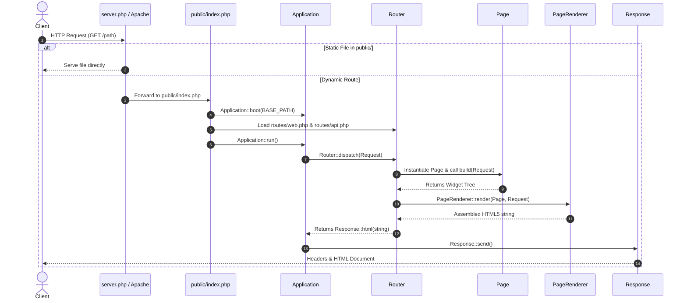

# StackFlow Framework Technical Architecture Documentation

> **Target Audience**: Core framework developers, contributors, and maintainers extending StackFlow's engine and capabilities.  
> *(If you are building an application on top of StackFlow, please refer to [`README.md`](README.md) instead).*

---

## 1. Architectural Philosophy & Design Principles

StackFlow is designed as a **lightweight, zero-dependency micro-kernel** that challenges traditional PHP MVC architecture. 

### Core Paradigms:
1. **Single Application per Project**: StackFlow projects host one unified application. Websites and web portals use separate installations, avoiding cross-module controller bleeding.
2. **Elimination of Controller-View Separation**: Instead of a controller assembling arrays and passing them to an untyped `.phtml` or `.blade.php` template, the entire UI is represented as a **composable, strongly-typed tree of PHP Widgets** returned by `Page::build(Request $request): Widget`.
3. **Protected Core Separation**:
   - `framework/` (`StackFlow\` namespace): Protected framework engine. Treated as an internal vendor dependency. Application developers should never modify code in this folder.
   - `app/` (`App\` namespace): Application workspace for pages, models, widgets, and APIs.
4. **Minimal External Dependencies**: The framework relies strictly on PHP 8.2+ native capabilities (`PDO`, `file_get_contents` with stream contexts, `json_encode`, `Filter`). Third-party packages are restricted to battle-tested foundational tools (`symfony/console` for CLI, `vlucas/phpdotenv` for environment parsing).

---

## 2. Request Lifecycle & Execution Pipeline



### Detailed Lifecycle Steps:
1. **Request Reception**: Request arrives at `server.php` (development) or `public/.htaccess` (production).
2. **Bootstrap (`Application::boot`)**:
   - `Env::load()` reads `.env` variables into `$_ENV` and `getenv()`.
   - `Config::load()` parses all configuration files in `app/config/*.php`.
   - `Debugger::boot()` records `STACKFLOW_START` timestamp and initializes query/log memory buffers.
   - `ErrorHandler::register()` hooks `set_exception_handler`, `set_error_handler`, and `register_shutdown_function`.
   - `ThemeManager::boot()` registers the built-in `DefaultTheme`.
   - `DB::configure()` registers MySQL/SQLite connection profiles.
   - Default container bindings (`Request`, `Router`, `Session`, `Auth`) are registered.
3. **Route Loading**: `routes/web.php` and `routes/api.php` register endpoints into `Router`.
4. **Dispatching (`Router::dispatch`)**:
   - The path is matched against regex capture groups.
   - Middleware pipeline runs sequentially; non-null `Response` short-circuits execution.
   - If target class is a `Page`, `PageRenderer::render()` transforms the returned `Widget` tree into an HTML5 document.
   - If target is an API controller method, its returned `Response` is received directly.
5. **Output**: `Response::send()` emits HTTP headers and outputs the response payload.

---

## 3. Core Subsystems

### 3.1 Application Container (`StackFlow\Core\Application`)
A lightweight Dependency Injection container and framework bootstrap:
- **Singleton**: `Application::boot(string $basePath)` ensures a single runtime instance.
- **Service Container**: Supports `bind(string $abstract, Closure $factory)` and `singleton(string $abstract, Closure $factory)`.
- **Path Helpers**: `path()`, `appPath()`, and `frameworkPath()` provide normalized filesystem paths across operating systems.

### 3.2 Router (`StackFlow\Core\Router`)
- **Route Registration**: Static methods `get()`, `post()`, `put()`, `patch()`, `delete()`, and `group(['middleware'], Closure)`.
- **Parameter Pattern Matching**: Converts `{param}` placeholders into named regex groups:
  ```php
  $regex = preg_replace('/\{([a-zA-Z_][a-zA-Z0-9_]*)\}/', '(?P<$1>[^/]+)', $pattern);
  ```
- Captured parameters are injected into `$request->params` prior to page execution.
- If a route matches but the HTTP verb is incorrect, a `405 Method Not Allowed` response is returned.
- If no route matches, a redesigned Laravel-style `404 Not Found` page is rendered (matching the error reporting theme) with a live route inspector in debug mode, or clean JSON if the request is AJAX or targeting `/api`.

### 3.3 Request & Response (`StackFlow\Core\Request` / `Response`)
- **Immutability & Safety**: All primary request properties (`$method`, `$uri`, `$path`, `$query`, `$body`, `$headers`) are `public readonly`.
- **Method Spoofing**: Automatically recognizes `_method` POST fields for form emulation of `PUT`, `PATCH`, and `DELETE`.
- **Factory Methods**: `Request::capture()` parses superglobals; `Request::create()` enables headless execution for tests.
- **Response Builders**: Static helpers `Response::html()`, `Response::json()`, `Response::redirect()`, and `Response::notFound()`.

### 3.4 Database & Query Engine (`StackFlow\Database`)
- **`DB` Connection Pool**: Lazily instantiates PDO connections upon first query execution. Connection configurations are mapped from `app/config/database.php`.
- **Driver Layer**:
  - `StackFlow\Database\Drivers\MySQLDriver`: Establishes UTF-8mb4 MySQL connections with `PDO::ERRMODE_EXCEPTION`.
  - `StackFlow\Database\Drivers\SQLiteDriver`: Establishes SQLite database connections with foreign key constraints enabled.
- **`QueryBuilder`**: Fluent SQL builder supporting `select()`, `where()`, `orWhere()`, `whereIn()`, `join()`, `orderBy()`, `paginate()`, `insert()`, `update()`, and `delete()`. All values use PDO prepared statements to eliminate SQL injection vulnerabilities.
- **`Model` (Active Record)**:
  - Table names are inferred automatically by converting CamelCase model names to snake_case plurals (`Student` -> `students`).
  - Mass assignment protection via `protected static array $fillable`.
  - Attribute visibility control via `protected static array $hidden` for `toArray()` and `toJson()`.
  - Validation engine via `protected static array $rules` with errors captured via `$model->errors()`.
  - Lifecycle hooks: `beforeSave()`, `afterSave()`, `beforeDelete()`, `afterDelete()`.

---

## 4. Widget Engine Architecture

Widgets in StackFlow are pure PHP classes that render accessible HTML pre-styled with Tailwind CSS utilities.

### 4.1 Base Widget (`StackFlow\Widgets\Widget`)
All widgets extend the abstract base `Widget`:
```php
abstract class Widget
{
    protected array $props = [];

    public function __construct(array $props = []) { $this->props = $props; }
    abstract public function render(): string;
    public static function make(array $props = []): static { return new static($props); }
    public function __toString(): string { return $this->render(); }
}
```

### 4.2 Key Engine Methods for Widget Authors:
- **`$this->prop(string $key, mixed $default = null)`**: Safely read a prop value.
- **`$this->classes(string ...$classes)`**: Joins non-empty class names into a single clean Tailwind string.
- **`$this->renderChild(mixed $child)`**: Recursively renders a child widget, string, or null.
- **`$this->renderChildren(array $children)`**: Recursively renders an array of child widgets.
- **`$this->attr(string $name, mixed $value)`**: Renders valid HTML attributes (e.g. `disabled` for `true`, `name="val"` for strings).
- **`$this->e(string $value)`**: XSS-safe HTML escaping via `htmlspecialchars`.

### 4.3 Widget Hierarchy:
- **Layout**: `Scaffold`, `Container`, `Column`, `Row`, `Grid`.
- **Input**: `Form`, `Button`, `Input`, `Select`, `Checkbox`, `Radio`, `SwitchToggle`, `FileInput`, `Textarea`, `Hidden`.
- **Display**: `Text`, `Heading`, `Link`, `Image`, `Icon`, `Avatar`, `Badge`, `Divider`.
- **Container**: `Card`, `Section`, `Modal`, `Drawer`.
- **Navigation**: `Navbar`, `Sidebar`, `Tabs`, `Dropdown`, `Breadcrumb`.
- **Data**: `Table`, `ListView`, `Pagination`.
- **Feedback**: `Alert`, `Toast`, `Spinner`, `ProgressBar`, `Skeleton`, `EmptyState`.

---

## 5. Page Rendering, Layout Engine & Theming

### 5.1 The `Page` Contract (`StackFlow\Page\Page`)
A Page represents a complete route destination:
- `protected ?string $layout = null`: Master Layout class (e.g. `\App\Layouts\AdminLayout::class`). If null, the page renders standalone.
- `public function layout(): ?string`: Returns the layout class name or null.
- `public function layoutProps(): array`: Returns custom props passed to the layout wrapper.
- `public function content(Request $request): ?Widget`: Primary content widget tree when extending a layout.
- `public function build(Request $request): Widget|Response`: Root widget builder; by default delegates to `content($request)`.
- `public function action(Request $request): ?Response`: AJAX/API endpoint handler for form submissions and dynamic mutations.
- `public function title(): string`: Document title.
- `public function meta(): array`: Custom SEO and OpenGraph tags.
- `public function scripts(): array` / `public function styles(): array`: Page-specific asset links.
- `public function theme(): string`: Theme mode (`'light'`, `'dark'`, or `'auto'`).

### 5.2 Master Layout System (`StackFlow\Layout\Layout`)
Master layouts serve as reusable shells (sidebars, footers, navbars, user status controls) that wrap page content:
```php
namespace StackFlow\Layout;

abstract class Layout
{
    abstract public function wrap(Widget $content, Request $request, Page $page): Widget;
}
```
Layouts can also be implemented as standard `Widget` classes that receive `child`/`body` props.

### 5.3 The `PageRenderer` Pipeline (`StackFlow\Page\PageRenderer`)
1. **Tree Resolution**: Executes `$page->build($request)` to acquire the page's root widget tree. If a `Response` is returned directly, it terminates the pipeline immediately.
2. **Layout Wrapping (`applyLayout`)**:
   - Inspects `$page->layout()`.
   - If null/empty: passes `$rootWidget` through directly (allowing standalone pages with custom scaffolds and navbars).
   - If an instance of `StackFlow\Layout\Layout`: invokes `wrap($rootWidget, $request, $page)`.
   - If an instance of `StackFlow\Widgets\Widget`: instantiates with merged layout props, `child`, `page`, and `request`.
3. **HTML Rendering**: Renders the complete widget tree to HTML via `$rootWidget->render()`.
4. **Universal Client Runtime & Toasts**:
   - Injects the StackFlow Client JS runtime (automatic AJAX form submit interceptor, modal manager, confirmation dialog trigger, and toast notification engine).
   - Plays back any server-side session flash messages (`success`, `error`, `warning`, `info`) as dismissible StackFlow toasts.
5. **Theming & Assets**:
   - Injects the **FOUC-Prevention Dark Mode Script** (checks `localStorage` and system `prefers-color-scheme`).
   - Injects `ThemeManager::renderHead()` (Google Fonts, Tailwind CSS config, CSS variables).
6. **Debug Toolbar**: If `APP_DEBUG=true`, injects the non-intrusive bottom performance toolbar.

---

## 6. Native AI Subsystem (`StackFlow\AI`)

The AI engine uses native PHP stream contexts (`file_get_contents`) instead of heavyweight HTTP client libraries, keeping the framework fast and portable.

### Architecture:
- **`StackFlow\AI\Contracts\AIDriverInterface`**:
  ```php
  interface AIDriverInterface
  {
      public function generate(string $prompt, array $options = []): string;
      public function chat(array $messages, array $options = []): string;
  }
  ```
- **`StackFlow\AI\AI` (Static Facade)**: Resolves the default driver configured in `app/config/ai.php` or a specific driver via `AI::driver('openai')`.
- **Drivers**:
  - `GeminiDriver`: Communicates with Google Generative Language API (`v1beta`).
  - `OpenAIDriver`: Communicates with OpenAI Chat Completions API (`v1/chat/completions`).
  - `OllamaDriver`: Communicates with local Ollama HTTP endpoints (`api/generate` and `api/chat`).

---

## 7. Extending Core Framework Features

### Guidelines for Framework Contributors:
1. **Never pollute `app/`**: Framework features must reside inside `framework/` under the `StackFlow\` namespace.
2. **Maintain Strict Types**: Every framework file must begin with `declare(strict_types=1);` and utilize PHP 8.2 features (typed properties, return types, match expressions, readonly properties).
3. **Composer Autoloading Integrity**:
   - When adding a new sub-namespace (e.g. `framework/Queue/`), directory casing must match namespace casing exactly to maintain strict PSR-4 compliance across Linux, macOS, and Windows.
   - Run `composer dump-autoload` to verify that zero classes are skipped.
4. **Widget Backward Compatibility**:
   - When creating or modifying widgets, never remove `$this->prop('class')` merging; developers rely on custom class injection to override styling.
   - Always ensure `render()` remains public and overridable.
5. **Database Drivers**:
   - New database drivers (e.g. PostgreSQL) must implement PDO connection initialization and be registered in `DB::connection()` match expression.

---

## 8. CLI Command Development

To add a new CLI command to `php stackflow`:
1. Create a class in `framework/Console/Commands/` extending `Symfony\Component\Console\Command\Command`.
2. Configure arguments and options in `configure()`.
3. Implement execution logic in `execute(InputInterface $input, OutputInterface $output): int`.
4. Register the new command instance in root executable `stackflow` under `$app->addCommands([...])`.
